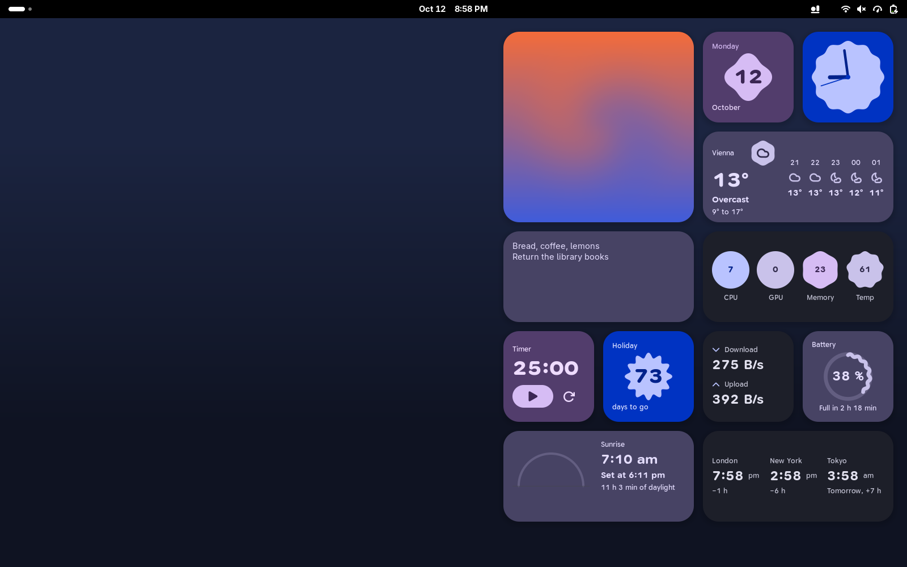
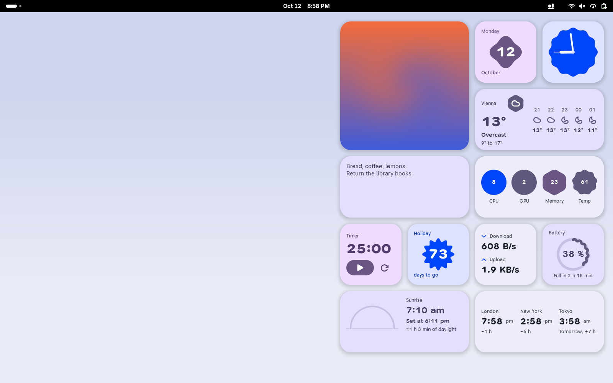
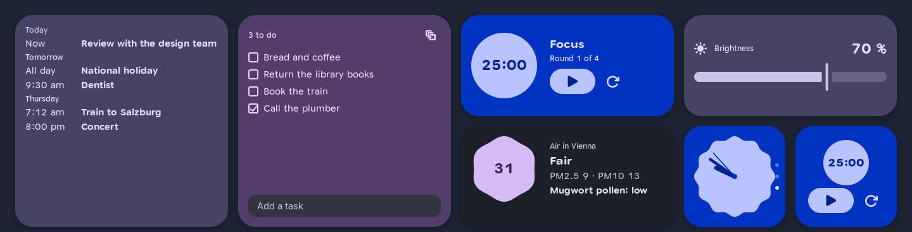
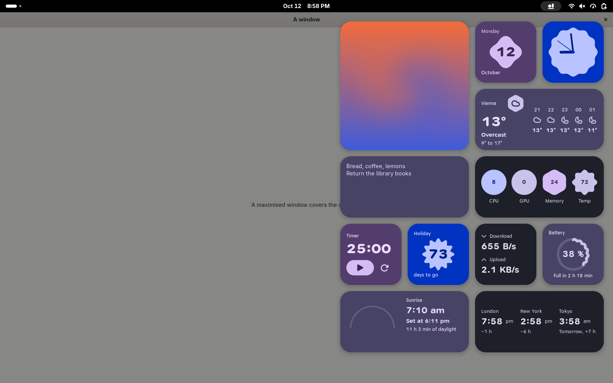
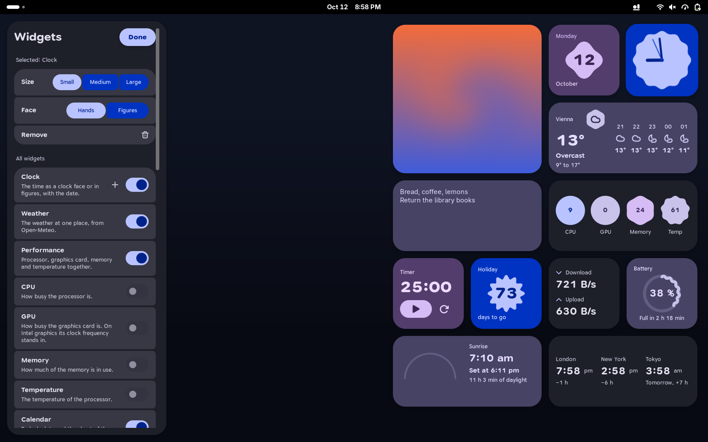
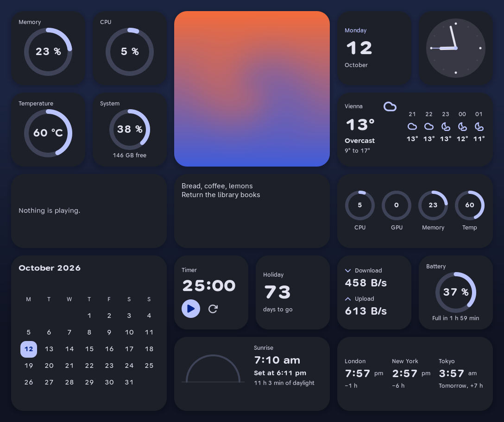
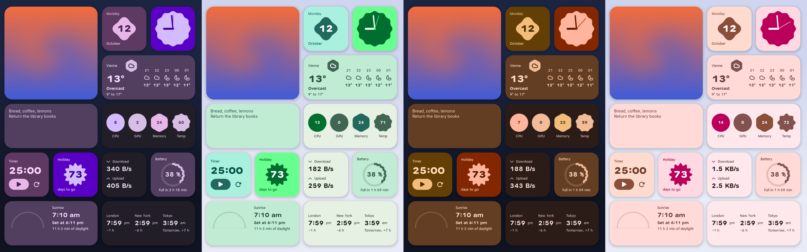
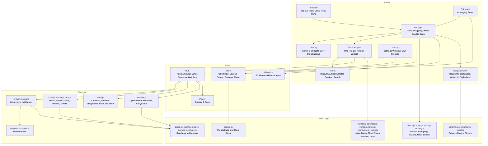

<div align="center">
  <h1>Ledge</h1>
  <p><strong>Desktop widgets for GNOME Shell in the manner of macOS: a clock, the load of the machine, the weather and twenty-three more, placed freely on the desktop and shown over the windows from the top bar.</strong></p>

  <p>
    
    
    
    
    
    
    
    
  </p>
</div>

---



**Ledge** puts widgets on the wallpaper, beneath the windows. Each one can be dragged anywhere, comes in up to **three sizes**, and can be switched on and off. An icon in the top bar brings them **over the windows**: for a look while the pointer rests on it, or held there with a click.

A widget only reads what it shows **while it can be seen**. Behind a maximised window, in the overview, on the lock screen and on a machine nobody is using, nothing runs.

Ledge is an independent project. It is not made, endorsed or supported by **Anthropic**; Claude is Anthropic's name for its own product, and the Tally widget only shows what the Tally extension recorded.

The values in the screenshots are those of the laptop they were taken on; the weather is a real answer for Vienna.

---

## Features

- **Twenty-Six Widgets:** Time, load, weather, media and small tools; the full list is below.
- **Three Sizes:** **Small** (160 px square), **medium** (twice as wide) and **large** (twice as wide and high). Each size has a layout of its own.
- **Free Placement:** Drag a widget anywhere. On release it rests on an **8 px grid**, or flush with a neighbour when one of its edges is near.
- **Look and Hold:** Rest the pointer on the top bar icon and the widgets appear over the windows for as long as it stays. A click holds them there and makes them usable.
- **Stacks:** Several widgets on one place. The wheel or the dots down the edge turn the stack; only the widget on top runs.
- **A Shortcut:** **Super+W** holds the widgets over the windows and lets them go again. Another combination can be recorded.
- **A Click Opens the App:** The weather opens Weather, the calendar Calendar, a load the system monitor. One switch turns it off.
- **Arranging Mode:** A panel in the same design switches widgets on and off, sets up the one you clicked, and chooses colour, see-through and motion.
- **Several Screens:** Each screen has **its own** widgets, or all widgets are **mirrored** on every screen, or they show on the **main screen only**.
- **Two Looks:** **Expressive**, with tiles in the tones of the colour scheme and values on shapes that grow with them, or **calm**, with neutral tiles and colour only in rings and lines. One switch changes all widgets.
- **Five Colour Styles and the Wallpaper's:** **Blue**, **violet**, **green**, **orange** and **pink**, each in light and dark, following the system's colour scheme. A sixth style takes its colours **from the wallpaper** and changes with it.
- **Motion in Three Steps:** **Motion** lets things glide instead of jump. **Expressive motion** puts them on springs: the widgets swing in as one sheet, rings fill up and numbers count as they arrive, a tile gives way under the press, and a wave that shows a value travels for as long as it is seen: faster while a timer or music runs, forward while the battery charges and back while it drains. Charts move on by a step, lists come in line by line, and a widget cheers when its timer ends. **Always moving** keeps shapes turning while nothing happens. Each step has its own switch.
- **Carried Along:** The arrangement, the look and the place of the weather are saved to one file and loaded on another machine.
- **Quiet When Unseen:** Readings stop behind maximised windows, in the overview and after **20 minutes** without input; on battery every interval doubles.



---

## The Widgets

| Widget | Sizes | Shows | Read from |
| :--- | :--- | :--- | :--- |
| **Clock** | S M L | The time as a clock face or in figures, with the date | System clock |
| **Calendar** | S M L | Today's date and the sheet of the month | System clock |
| **Weather** | S M L | Now, the next hours and five days for one place | **Open-Meteo** |
| **Daylight** | S M | Sunrise, sunset and where the sun stands | The same forecast |
| **Air** | S M | The European air quality index, fine dust and the strongest pollen | **Open-Meteo** air quality |
| **Up next** | M L | The calendar's entries of the coming week | The entries GNOME Shell holds for its date menu |
| **Performance** | M L | Processor, graphics card, memory and temperature together | See below |
| **CPU** | S M | Share of processor time in use, with its recent course | **`/proc/stat`** |
| **GPU** | S M | Load of the graphics card; on Intel graphics its clock frequency | **`nvidia-smi`** or **`/sys/class/drm`** |
| **Memory** | S M | Memory in use | **`/proc/meminfo`** |
| **Temperature** | S M | Temperature of the processor | **`/sys/class/hwmon`** |
| **Top processes** | M L | The programs using the most processor time or memory | **`/proc/<pid>/stat`** |
| **Network** | S M | Download and upload per second | **`/proc/net/dev`** |
| **Storage** | S M | How full the disks are | File system information |
| **Battery** | S M | Charge and time left; stays away without a battery | **UPower** |
| **Volume** | S M | Loudness of the sound output, with a slider and mute | GNOME Shell's sound control |
| **Brightness** | S M | Brightness of the screen, with a slider; stays away where no screen can be dimmed | GNOME Shell's brightness control |
| **Now playing** | S M L | Title, artist, cover and controls of what a player plays | **MPRIS** on the session bus |
| **Tally** | S M | Session and week limits of a Claude plan | The cache of the [**Tally**](https://github.com/tomsliikee/tally) extension |
| **World clock** | S M L | The time in up to six cities and how far ahead they are | System time zones |
| **Timer** | S M | A countdown that notifies at its end, or a stopwatch | — |
| **Pomodoro** | S M | Focus and breaks in turn: four rounds, then a long break | — |
| **Countdown** | S M | The days until a date of your choice | — |
| **Note** | S M L | A few lines of your own | — |
| **Tasks** | M L | A list to tick off | — |
| **Photo** | S M L | A picture from a folder, a different one every hour | The folder; read only |

- **More Than One:** Clock, timer, pomodoro, countdown, note, tasks and photo can be added several times, each with its own settings.
- **GPU, Honestly:** **NVIDIA** cards report their load through `nvidia-smi`, **AMD** cards through `gpu_busy_percent`. **Intel** graphics report no load without extra rights, so the widget shows where the clock frequency stands between its lowest and highest, and labels it **GPU clock**.
- **Pollen Only in Europe:** Open-Meteo has pollen counts for Europe; elsewhere the Air widget shows the index and the dust alone. The words for a pollen count (low, moderate, high) are rough bands, not medical advice.
- **Up Next Sees What the Shell Sees:** The calendar service keeps one span of time for everyone who asks, so Ledge asks for none and reads what the shell has loaded: the weeks shown in the date menu. An entry beyond them does not show, and while another month is open in the date menu the widget may be empty.
- **Notes and Tasks Are Written While Held:** Text can only be typed while the widgets are held over the windows; on the bare desktop the keyboard belongs to the focused window.



In this picture the calendar entries and the brightness are stood in for: the shell it was taken in has no calendar account and no screen to dim.

---

## Look and Hold



| Action on the top bar icon | Result |
| :--- | :--- |
| **Rest the pointer** on it for 0.3 s | The widgets appear over the windows, at their places on the desktop, until the pointer leaves |
| **Click** | The widgets are held and can be used and dragged; a click into the open or **Esc** lets go |
| **Secondary click** | A menu with **Edit widgets** and **Settings** |

| Elsewhere | Result |
| :--- | :--- |
| **Super+W** | The same as a click on the icon: held, and let go when pressed again |
| **Click on a widget** | Opens the app that belongs to it and lets the widgets go. Notes, tasks, timers and photos open nothing |
| **Wheel over a stack** | Turns it to the next or the previous widget |

---

## Arranging



- **All Widgets:** One switch per widget. A widget that is switched off keeps its place, size and settings.
- **The Selected One:** Click a widget to choose its **size** and what is particular to it: the clock's face, a countdown's date, the cities of a world clock, a photo's folder.
- **Stacks:** Drag a widget onto the middle of another whose size it offers and it is laid on top. The panel lists the widgets of the selected stack and takes one out again.
- **On Battery:** On a machine with a battery, each widget can be set to step aside while it is unplugged.
- **Look:** One of five colours, the **expressive** or the calm look, **see-through** tiles that let the wallpaper show, and the three switches for **motion**: at all, on springs, and always moving. A calm wave is drawn **15** times a second while it is in view, a running one and what always moves **30** times. What always moves rests on battery; the waves do not.
- **Screens:** With more than one screen, the choice between **own**, **mirrored** and **main only**. With own layouts, a widget dragged to another screen belongs to it; when that screen is unplugged the widget shows on the main one and returns later.
- **Also as a Window:** The same settings are in the extension's ordinary **settings window**; both write to the same place. The shortcut is recorded there, and the arrangement is saved to a file and loaded from one.

---

## What It Costs

A source runs only while a widget that needs it can be seen, and several widgets share one source.

| Reading | Interval | On battery |
| :--- | :--- | :--- |
| **Processor, memory, temperature, network, GPU** | 2 s | 4 s |
| **Top processes** | 5 s, in a helper process | 10 s |
| **Clock** | Once a minute; once a second with a second hand | Same |
| **Storage** | 60 s | 120 s |
| **Weather** | 30 min | 60 min |
| **Air** | 60 min | 120 min |
| **Photo** | 60 min | 120 min |
| **Battery, media, Tally's limits, calendar, volume, brightness** | Only when they change | Same |

- **Unseen Means Stopped:** A maximised or full-screen window on a screen stops the widgets of that screen. So do the overview and **20 minutes** without keyboard or pointer input. On the lock screen GNOME switches the extension off.
- **Measured:** In a headless GNOME Shell on an **Intel Core i5-8350U**, the four starting widgets cost about **1.8 %** of one core with motion and **0.8 %** without; with nothing in view the shell stayed at its own **0.25 %**. Nine widgets on battery, four of them with a travelling wave, cost about **15.9 %** with expressive motion and **1.9 %** without. A real screen was not measured.
- **Kept Off the Shell's Thread:** Ranking the processes means reading a file for each of them, about **25 ms** in all, so a helper process does it. `nvidia-smi` runs once and keeps reporting instead of being started every two seconds.

---

## What Leaves the Machine

| Request | Sent | When |
| :--- | :--- | :--- |
| **Forecast** from `api.open-meteo.com` | The coordinates of the chosen place, to three decimals | While a weather or daylight widget can be seen, every 30 minutes |
| **Air quality** from `air-quality-api.open-meteo.com` | The same coordinates | While an Air widget can be seen, every 60 minutes |
| **Place search** at `geocoding-api.open-meteo.com` | What you type into the search | When you search |
| **Cover art** | A request to the address a media player gives for its cover | When that player's song changes and the address is on the web |

Without those widgets nothing is requested. There is no account, no key and no analytics. Weather data is by [**Open-Meteo**](https://open-meteo.com), under CC BY 4.0.

---

## Look and Feel

The interface is built with **Toms Expressive Design**, the design system in **`toms-expressive-design/`**.

- **Shapes Carry Values:** In the expressive look a load stands on a shape that swells from a circle to a many-rayed form as it rises, the day of the month on a clover, a countdown on a burst. The clock's face is scalloped and rings ripple.
- **Tones by Kind:** Each widget has a tone of the scheme (primary, secondary or tertiary); the four loads keep neutral tiles and carry their tone in the shape.
- **Numbers Lead:** A large number, a quiet label that says what it is, and at most one sentence beside it.
- **Type With a Voice:** **Google Sans Flex**, a variable font. Numbers are heavy and wide, labels narrow and quiet.
- **Status Colours Mean Something:** A ring turns to the warning colour from **75 %** and to the error colour from **90 %**; a battery does so when it runs low.
- **A Style From the Wallpaper:** The picture is reduced to 64 px, its colours to a few, and the one that carries it becomes the seed of a scheme, derived the way the five fixed styles were. A wallpaper that changes through the day changes the colours with it. Without a picture the wallpaper's plain colour is the seed.
- **Generated, Not Typed:** `tools/build-tokens.js` writes the stylesheet and the colour values from **`toms-expressive-design/tokens.json`**. The one colour written by hand is the scrim behind held widgets, for which the tokens have no role.





---

## Getting Started

You need **GNOME Shell 50**. Everything Ledge uses ships with it.

**1. Clone:**
```bash
git clone https://github.com/tomsliikee/ledge.git ~/projects/ledge
```

**2. Install:**
```bash
~/projects/ledge/install.sh
```

**3. Log out and back in.** GNOME Shell on Wayland loads a new extension only at login.

The script compiles the settings schema, links the extension into **`~/.local/share/gnome-shell/extensions`**, enables it, and installs **Google Sans Flex** when the machine has none. To update, `git pull`, run the script again and log in again.

**Run the unit tests:**
```bash
for t in tests/*.test.js; do gjs -m "$t"; done
```

**Run a script in a GNOME Shell without a screen** (screenshots and a log go to `/tmp/ledge-headless`):
```bash
tools/headless/run.sh gallery 100
```

**Regenerate the stylesheet** after changing the template or the design tokens:
```bash
node tools/build-tokens.js
```

---

## How It Works

Three layers: **sources** that read, **pure logic** that runs outside the shell and is covered by **124** unit tests, and **views** drawn with **St** and **Cairo**.



### Data Storage & Disk Paths

| Path | Purpose |
| :--- | :--- |
| **dconf, `/org/gnome/shell/extensions/ledge/`** | The widgets with their places, sizes, stacks and settings; colour, look, see-through, the three steps of motion, screens, the shortcut and the place for the weather |
| **`~/.cache/ledge/thumbs/`** | Photos and covers cut to the size of their widget |
| **`~/.cache/ledge/wallpaper.css`** | The stylesheet of the style taken from the wallpaper |
| **`~/.cache/tally/`** | Tally's records of the Claude limits. Read only |

---

## Platform Support Matrix

| Platform | Status |
| :--- | :--- |
| **GNOME Shell 50** on **Wayland** (Fedora 44) | ***Tested*** in a headless shell. In a real session it was installed on one laptop on 2026-10-12, where the widgets, the top bar icon and holding them over the windows were used; nothing else was checked there |
| Other GNOME Shell versions | ***Planned***: `metadata.json` names version 50 only |

| Part | State | How |
| :--- | :--- | :--- |
| **Parsing, formatting, layout, snapping, stacks, time zones, timer, pomodoro, tasks, backup, air, agenda, colour schemes, springs, waves** | *tested* | 124 unit tests |
| **All twenty-six widgets, every size, light and dark, both looks** | *tested* | Rendered in a headless GNOME Shell 50.5 with this laptop's real readings. The warning and error colours on shapes were not seen: no reading was that high |
| **Weather** | *tested* | A real forecast for Vienna from Open-Meteo on 2026-10-12. The place search was not run from the panel |
| **Dragging and snapping** | *tested* | With a virtual pointer in the headless shell; the stored place lay on the grid |
| **Look on hover, hold on click, menu on secondary click** | *tested* | With a virtual pointer, over a maximised window |
| **Stopping when unseen** | *tested* | No source ran behind a maximised window, in the overview, or 3 s after input with a 2 s threshold; all ran again after |
| **Arranging mode** | *tested* | Opened, a widget selected by a click, widgets added, colour and see-through changed. Text fields were not typed in |
| **Settings window** | *tested* | Opened in the headless shell; a switch clicked there added the widget on the desktop |
| **Several screens** | *tested* | Two virtual monitors: a drag to the other one, a widget of a missing monitor, mirrored and main only. Unplugging a real monitor was not tried |
| **Stacks** | *tested* | With a virtual pointer: two widgets stacked by a drag, a third added, one of another size refused, turned with the wheel and a dot, moved as one, taken out |
| **Shortcut** | *tested* | Super+W from a virtual keyboard held the widgets and let them go; with none set nothing happened. Recording another combination in the settings window was not tried |
| **Click opens the app** | *tested* | A click on the held calendar started GNOME Calendar; not while arranging, not with the switch off |
| **Tasks and Pomodoro** | *tested* | A task ticked off with the pointer and one added through the field; a round started by its button. A phase running to its end was only tested as logic |
| **Air** | *tested* | A real answer for Vienna on 2026-10-12. An index high enough for the warning colours was not seen |
| **Up next** | *tested* | With a calendar stood in for: entries by day, a change of the calendar, and no listener left behind. With the real source of a shell without accounts it showed that nothing is ahead. Real calendar accounts were not tried |
| **Volume** | *built* | Read the real output device in the headless shell. Setting the loudness and muting were not tried, so as not to change the sound of the machine |
| **Brightness** | *tested* | With the shell's scale stood in for: dragged with the pointer, turned with the wheel, pressed while held. The headless shell has no screen to dim; a real backlight was not tried |
| **Colours from the wallpaper** | *tested* | The library in the extension gives the same colours as the four derived styles that ship. In the headless shell: a plain colour, a picture for each scheme, a wallpaper that changes through the day, a missing picture. A real wallpaper was only read outside the shell |
| **Stepping aside on battery** | *tested* | With the battery stood in for: the widget left, its source stopped, and both returned |
| **Saving and loading the arrangement** | *built* | The file's content is unit tested; the two dialogs were not clicked |
| **Switching off and on** | *tested* | Disabled and enabled in the running shell without an error |
| **GPU on NVIDIA and AMD** | *built* | Only the parser of the `nvidia-smi` line is tested; no such card was at hand |
| **Now playing** | *built* | Rendered with nothing playing; no player was run |
| **Half pace on battery** | *built* | Not observed switching |
| **Motion** | *tested* | In the headless shell, by reading the values while they moved: the sheet of widgets passed its size and settled, a ring was part of the way 70 ms in, a pressed tile and button shrank and came back, a stack's dot stretched, ticked tasks glided to their places, the wave travelled while a timer and a stood-in player ran and stopped with them, shapes turned only with **Always moving** on, and nothing of it happened with the switches off. With the battery stood in for: its wave travelled back while it drained and forward, faster, while it charged, sank to half its height at 8 %, and was stirred by a new reading; a chart moved on by a step, processes rolled over, entries came in one after the other, a picture faded in, and the content swelled when a timer ended and when the power was plugged in. Counting network rates, volume and brightness is *built*, not run. How it looks and feels on a real screen was not watched |
| **Typing a note** | *built* | Rendered with text; typing needs a real keyboard |

Ledge places its widgets in the shell's background group, which is not a public interface of GNOME Shell and may change with a new version. The same holds for the three readings it takes from the shell: the date menu's calendar entries, the sound control and the brightness control. Those are kept in one file, `extension/lib/sources/shell.js`.

---

## License

**Ledge** is released under the [**MIT License**](LICENSE).

**`extension/lib/vendor/material-color-utilities`** holds a part of Google's **material-color-utilities** (version 0.4.0) under the **Apache License 2.0**; what was changed is listed in the README beside it.

The font in **`toms-expressive-design/fonts`**, **Google Sans Flex**, is the work of the Google Sans Flex Authors and comes under the **SIL Open Font License 1.1**; its text is in [`toms-expressive-design/fonts/OFL.txt`](toms-expressive-design/fonts/OFL.txt).
